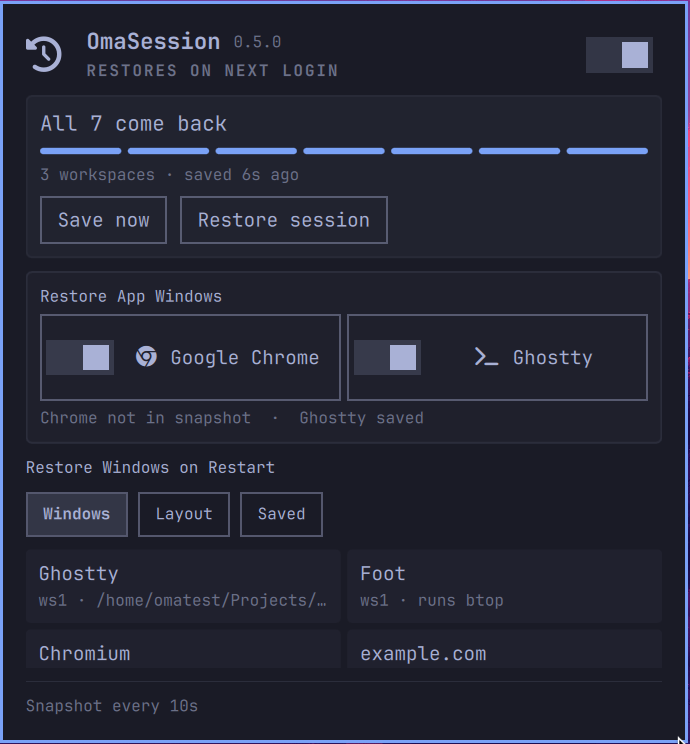
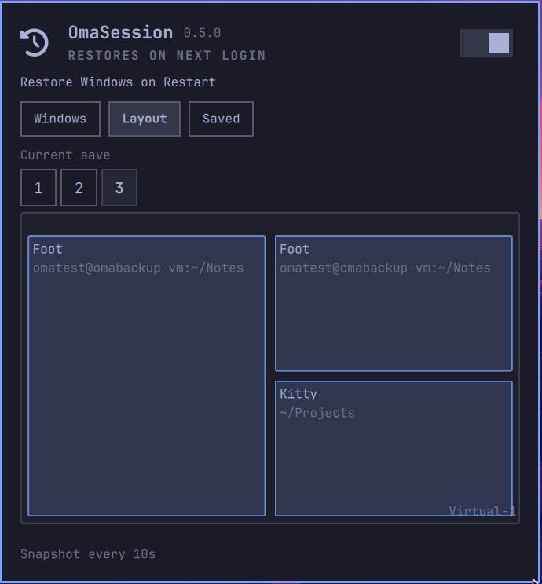
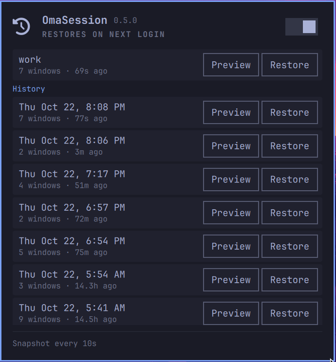
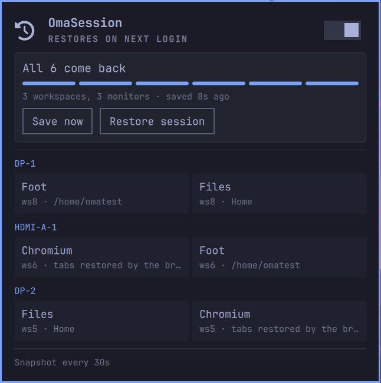

# OmaSession

[](https://github.com/tcballard/omarchy-badges)

**We Can Bring Every Window Back.**

OmaSession reopens what you had open, where you had it, after a reboot, a
logout or a crash. It is what macOS does with *"Reopen windows when logging
back in"*, built for Omarchy 4.



> **Status: usable end to end.** Save, restore, the guard, the resolver and
> the panel all read and write through the real CLI, with no mock data. See
> [Where it actually is](#where-it-actually-is) for what is verified where.

| | |
|---|---|
| **Any application** | The command to relaunch comes from the system itself (the `.desktop` index, the systemd scope, `/proc`), so it works beyond a fixed list of known apps. |
| **Terminals come back in place** | Same working directory, the same tmux session, and optionally the program that was running in them, such as `nvim` or `btop`. |
| **Browsers bring their own tabs** | The browser's crash recovery reopens its windows and tabs, for every profile that was open. Web apps reopen as web apps. |
| **Layouts** | Windows return to their workspace, monitor, size and floating state. Dwindle splits are rebuilt, and layouts that place windows by order get them back in their slots. |
| **History and named sessions** | Every change to the desktop is kept for a week, thinned over time. Save any arrangement under a name and restore it later. |
| **See it before you need it** | The panel lists what will come back, draws each saved workspace to scale and flags any window it can't relaunch, before the reboot. |
| **Never a worse save** | Every snapshot is checked against the screen it came from before it replaces the last one. A save that looks wrong is refused. |

## Why a new plugin

Tools written before Omarchy 4 drive the compositor with the pre-Lua `hyprctl
dispatch exec` and `keyword windowrule` syntax. Hyprland 0.56 with a Lua
config, the Omarchy 4 default, rejects that syntax *silently*, so the tool
reports success against an empty desktop.

| | hyprresume 0.5.0 | OmaSession |
|---|---|---|
| 6 mixed windows | 0/6 in 150s | **6/6 in 7s** |
| single-instance Chromium windows | does not launch | **4/4 in 3s** |
| after a real reboot | 0 restored | **4/4 in 5s**, plus the browser's own tabs |

## What comes back

### Any window

`lib/resolve.py` works out the command that brings a window back from the
system: the `.desktop` index, the systemd scope for Flatpaks, and
`/proc/<pid>/cmdline` as a last resort. It resolved 19 of 19 windows on a
real desktop. A window it can't resolve is shown in the panel before the
reboot, so you find out then and not after. Details in
[`docs/plans/003`](docs/plans/003-command-resolver.md).

### Terminals

Ghostty, foot, kitty and Alacritty reopen in the directory they were in. A
terminal attached to tmux reattaches to that same session instead of
opening a bare shell ([`docs/plans/005`](docs/plans/005-tmux-session-recovery.md)).

A terminal can also come back running the program it had in the foreground.
Only the programs you list are relaunched, since rerunning whatever was in
front could repeat a build or a delete:

```
$OMASESSION config set terminalPrograms "nvim,btop"
```

The program runs inside your shell (bash, zsh or fish), so it gets the PATH
your shell config sets, and quitting it leaves you at a prompt. Ghostty uses
`-e`, foot and kitty use `--`. When one Ghostty process serves several
windows, each program goes to the window whose title names it.

### Browsers

Chromium, Google Chrome, Brave and Vivaldi reopen their own windows and tabs
through their crash recovery. The session file survives the reboot intact.
What stops the browser from restoring it is one line in its profile,
`exit_type = "Crashed"`, written when the session teardown kills it.
OmaSession sets it back to `"Normal"` before launching the browser, so no
pre-shutdown hook is needed: 3 of 3 tabs came back with it, 0 of 3 without,
on Chromium and Chrome ([`docs/plans/001`](docs/plans/001-RESULTADO.md)).

- **Every profile.** The save records which profiles were open, and restore
  launches each one with `--profile-directory`.
- **Web apps.** A window opened with `--app=URL`, Omarchy's web apps
  included, reopens as the same app on the same profile. The URL comes from
  the window class or its desktop entry, and the browser from the window's
  process.
- **Reboot from the Omarchy menu.** The menu closes windows one at a time,
  and Chrome or Chromium would keep only the last one. Before launching the
  browser, OmaSession undoes those closes in each profile's session file,
  keeps the original aside and logs the decision in `last-restore.log`
  ([`docs/plans/008`](docs/plans/008-chrome-session-close-all.md)).
- **Browser restarts during a login.** When Chrome or Chromium restarts and
  reopens its windows on the current workspace, the next snapshot moves
  those same windows back to their saved workspaces. It matches them by
  title, never opens or closes a window, and keeps the previous snapshot
  until the windows are back in place. Turn it off with `browserRepair
  false`, or only for Chrome with `browserRepairChrome false`.

Chrome needs one extra step to restore reliably. See [Install](#install).

### Layout

Geometry, floating state and the monitor come back as they were. Workspace 3
is a different desk on each screen, so windows are grouped and restored by
the monitor they were on.

**Dwindle tiled layouts.** On a workspace where every window came back,
restore rebuilds the saved split directions and proportions and then checks
the resulting tiles. A workspace with missing or extra tiles, unsupported
settings or geometry that doesn't fit is skipped with a diagnostic. An
app-only restore can't rebuild just one app's part of a mixed layout. See
[`docs/tiled-layout.md`](docs/tiled-layout.md).

**Layouts that place windows by order.** Lua layouts (`hl.layout.register`)
and similar ones put each window in a slot by the order it arrived. For
these, restore opens every window on a hidden workspace first, then moves
them to their workspaces one by one in the order they had. Hyprland doesn't
report that order, and its client list keeps creation order after a swap,
so your Lua config can supply it: define a global `window_slot_order()` that
returns JSON like `{"3": ["0xaddr", ...]}`, filled from `ctx.targets` in your
layout's `recalculate`. Ordering only runs when that function exists, so
Dwindle and Master users see no change. `restoreOrder true` turns it on
anyway, using the client list order, and `restoreOrder false` turns it off.
If a restore is killed while windows are hidden, the timer skips its saves
until the next restore puts them back.

## The panel

The bar widget shows what was last captured and whether all of it can come
back, with **Save now** and **Restore session**. Below that:

- **Restore App Windows** has a card for Google Chrome and one for Ghostty.
  The Chrome button asks Chrome to restore its own windows and tabs and then
  places them. The Ghostty button reopens only the Ghostty windows. Each
  card's toggle stays visible when the app is closed: Chrome's controls
  `browserRepairChrome`, and Ghostty's controls `appRestoreGhostty`.
- **Windows** lists every saved window under its monitor and workspace, with
  its directory or program, and flags the ones that can't come back.
- **Layout** draws each workspace to scale from the saved monitor geometry
  (position, size, scale, rotation), so an ultrawide, a row of monitors or a
  portrait screen look like themselves.
- **Saved** lists your named sessions and the history, each with Preview
  (shown in the Layout tab) and Restore, plus **Save as** to name the current
  arrangement.

| Layout | Saved |
|---|---|
|  |  |



## History and named sessions

`last` is what login restores. Each time the desktop's shape changes (windows,
workspaces, slots or commands, not titles), a copy is also kept as
`history-<time>`: every change for 15 minutes, then one per 15 minutes for 2
hours, one per hour for a day and one per day for a week. You can also save
any arrangement under a name and bring it back later:

```
$OMASESSION save work          # save the current windows as "work"
$OMASESSION list               # named sessions and history, with ages
$OMASESSION restore work       # or restore history-20261021-222219
```

## Never a worse save

The worst thing a session saver can do is overwrite a good save with a bad
one, for example a snapshot of an empty desktop.
`lib/session-save.sh` writes each save to a staging copy, checks it against
the screen it was taken from, and only then publishes it. A save that can't
prove itself is refused and the previous one stays. `test/guard-cases.sh`
covers these refusals, including killing the save at random points while it
writes.

## Install

```
omarchy plugin add https://github.com/brenoperucchi/omasession --enable
```

That is the whole install. When the shell loads the plugin, its service
writes and enables the user-level snapshot timer (`systemctl --user`, no
root) and adds one marked login-restore line to
`~/.config/hypr/autostart.lua`. It runs again at every shell start and only
fixes what is missing or out of date. A login line you delete stays deleted,
a timer you disable with `systemctl --user disable` stays off, and after
`omasession uninstall` it sets nothing up again until you run `omasession
install`. Choices made under 0.5.0 carry over the same way.

While the plugin is disabled in the shell, the timer and the login line do
nothing. OmaSession needs `python3`, `jq` and `hyprctl`, all present on a
stock Omarchy install, and `tmux` only if a terminal is already a tmux client.

The CLI lives inside the plugin's own directory. `omarchy plugin add` clones
it there but doesn't put it on `PATH`, so the commands below spell out the
full path.

**Chrome only, one time, needs root.** This is a literal command, not a
script:

```
printf '%s\n' '{"RestoreOnStartup": 1, "PromotionalTabsEnabled": false, "DefaultBrowserSettingEnabled": false}' \
  | sudo install -D -T -m 644 /dev/stdin /etc/opt/chrome/policies/managed/omasession-no-promo.json
```

On the first launch after every version update, Chrome shows onboarding pages
instead of restoring the session, and drops the restore. Only a browser policy
file fixes that, since Chrome ignores the same setting written by hand. You
opt in and run it yourself, once. `omasession install` never writes it, and
nothing in this plugin runs as root. Chromium doesn't need it.

For another Chromium-based browser, use its policy directory with the same
file name and content: `/etc/chromium/policies/managed/`,
`/etc/brave/policies/managed/`, `/etc/vivaldi/policies/managed/` or
`/etc/opt/edge/policies/managed/`. `omasession install` and `uninstall`
check all five. `install -D -T -m 644` creates the directory if needed and
replaces the file at that exact name. The `-T` keeps it from copying *into*
a directory, or a symlink to one, that sits at that name; without it, a
symlink there would silently redirect the write. A symlink swapped into a
parent directory under `/etc` is still followed, but every directory from
`/etc` down is normally root-owned 0755, so that already takes root or a
broken package.

## Usage

```
OMASESSION=~/.config/omarchy/plugins/brenoperucchi.omasession/bin/omasession
$OMASESSION save [name]       # capture now, outside the timer's cadence
$OMASESSION restore [name]    # replay the last capture, or a named one
$OMASESSION list              # named sessions and history
$OMASESSION restore-app google-chrome      # restore Chrome's windows and tabs
$OMASESSION restore-app ghostty            # restore only the Ghostty windows
$OMASESSION restore-browser google-chrome  # move open Chrome windows back to their workspaces
$OMASESSION status --json     # what the panel reads
$OMASESSION layout [name]     # a saved session as geometry, for the Layout tab
$OMASESSION resolve           # the command each open window would resolve to
```

## Configure

From the panel's settings, or with the same CLI:

```
$OMASESSION config set saveIntervalSec 30      # how often the timer snapshots
$OMASESSION config set restoreOnLogin true     # restore automatically at login
$OMASESSION config set browserRestore true     # let the browser reopen its own tabs
$OMASESSION config set browserRepair true      # move restarted browser windows back
$OMASESSION config set browserRepairChrome true # include Chrome in that repair
$OMASESSION config set appRestoreGhostty true  # include Ghostty in the login restore
$OMASESSION config set terminalPrograms "nvim,btop" # programs a terminal comes back running
$OMASESSION config set restoreOrder auto       # slot order only with window_slot_order(); true/false force it
```

## Remove

Run `uninstall` first to leave nothing behind. The CLI lives inside the
plugin's directory, so after `omarchy plugin remove` nothing is left to clean
up the two unit files and the login-restore line. They stay inert (the timer
and the line both check that the CLI exists), but they stay:

```
OMASESSION=~/.config/omarchy/plugins/brenoperucchi.omasession/bin/omasession
$OMASESSION uninstall
sudo rm -f /etc/opt/chrome/policies/managed/omasession-no-promo.json   # only if you ran the browser policy command above
omarchy plugin remove brenoperucchi.omasession
```

`uninstall` disables the snapshot timer, removes only the login-restore line
it added, and prints the exact `sudo rm -f` for any browser policy file it
still finds. That file is machine-wide, so removing it is a separate command;
use whichever path it reports. Saved sessions under
`~/.local/share/omasession/` are left alone.

## Where it actually is

| Piece | State |
|---|---|
| `lib/replay.py`, restore | **works**, across real reboots in the lab |
| `lib/session-save.sh`, save and guard | **works**, covered by `test/guard-cases.sh` |
| `lib/resolve.py`, the application resolver | **works**, 19/19 on a real desktop |
| Terminal programs | **works** in Ghostty, foot and kitty, across a reboot |
| Browser profiles and web apps | **works** on Chromium and Chrome in the lab; Brave and Vivaldi not tested there |
| History and named sessions | **works**, on the snapshot timer |
| `Panel.qml`, the bar widget | **works**, reads `status --json`, `list` and `layout` live |
| `bin/omasession`, the CLI | **works**, exercised end to end in the lab |
| `bin/browser-setup --list-paths` | **works**, unprivileged, used by install and uninstall |

The suites in `test/` run without a desktop. The lab numbers come from a QEMU
guest running Omarchy 4 with Hyprland 0.56.2.

## Docs

- [`CHANGELOG.md`](CHANGELOG.md): release history and user-visible changes.
- [GitHub Releases](https://github.com/brenoperucchi/omasession/releases): tagged release notes.
- [`docs/DESIGN.md`](docs/DESIGN.md): what was measured, and what it forced.
- [`docs/PANEL.md`](docs/PANEL.md): the panel's states and the Omarchy shell
  traps that cost the most.
- [`docs/tiled-layout.md`](docs/tiled-layout.md): Dwindle reconstruction,
  requirements and testing.
- [`docs/plans/`](docs/plans/): every question, open and closed, with the
  measurement behind it.

## Related projects

- [OmaBackup](https://github.com/brenoperucchi/omabackup) backs up and
  restores Omarchy's dotfiles and configuration. OmaSession restores the live
  windows and workspaces on top of it.

## License

MIT.
