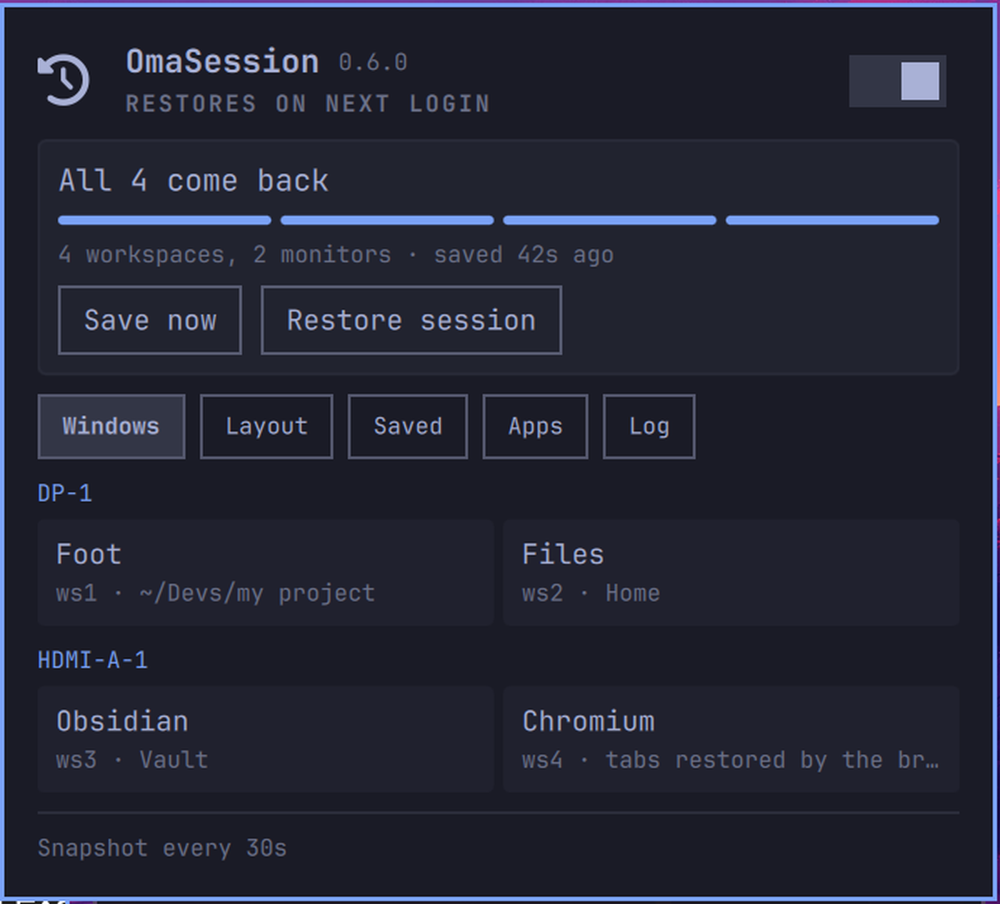

# Panel.qml — estado, e como iterar nele

**Status:** ligado ao CLI de verdade desde 2026-09-09. `mockMode: false` é o
default de produção: o painel lê `omasession status --json` por um `Process`
real, e os botões/toggle chamam `save`/`restore`/`config set` pelo mesmo
caminho. `mockMode: true` só existe para `test/shoot.sh`, que precisa de um
cenário fixo para capturar tela — não do que estiver de fato salvo no guest
naquele instante.



Dois estados no bloco `mock`, alternáveis pela propriedade `scenario` (só têm
efeito com `mockMode: true`):

| `scenario` | O que mostra | Por que existe |
|---|---|---|
| `healthy` | `All N come back`, sem avisos | O estado normal |
| `refused` | `N of M come back` em vermelho + banner `partial save blocked: ...` | O guard recusando é meia notícia boa (preservou a sessão) e meia ruim (o snapshot está mais velho do que parece). A versão que só escrevia no journal é como uma sessão se perdeu sem ninguém ver |

Existiu um terceiro estado, `contested`, para o banner "hyprresume's daemon is
writing the same session files" -- removido em 2026-09-10 junto com a própria
captura via hyprresume (ver `docs/plans/003-command-resolver.md`). A captura
agora é nossa (`lib/capture.py`), escreve só no diretório do OmaSession, e
outro processo escrevendo *seu próprio* `~/.local/share/hyprresume/sessions`
não compete com nada que a gente lê.

O bloco `mock` continua sendo **o contrato**: a forma que `status --json` tem
de produzir, mantida em sincronia manual com `lib/effective.py` +
`lib/captured.py`, que são quem de fato a produz agora.

## Composição atual do painel

Desde 2026-11-02 tudo o que vem depois do resumo fica em abas:

1. O cabeçalho mantém `OmaSession`, o estado “restores on next login” e o
   toggle. Quando o último restore teve problema, o estado vira “last restore
   had problems”.
2. Um único corpo rolável mostra o resumo do snapshot (`All N come back`, a
   régua, workspaces/monitores e horário), `Save now`/`Restore session`, os
   avisos e uma linha de abas: **Windows**, **Layout**, **Saved**, **Apps** e
   **Log**.
3. A aba **Apps** tem dois cards independentes, **Google Chrome** e
   **Ghostty**, cada um com um toggle compacto à esquerda. O Chrome grava
   browserRepairChrome e mantém a ação manual de mover janelas abertas; o
   Ghostty grava appRestoreGhostty e chama restore-app ghostty, adotando uma
   janela aberta ou lançando o comando salvo. O CLI detecta se cada executável
   está instalado e se há uma janela no snapshot; o card continua visível
   quando o app está fechado e fica desativado se o executável não existir. O
   resultado da última ação aparece logo abaixo.
4. A aba **Log** lê `omasession restores --json` e lista os restores
   guardados, do mais novo para o mais antigo, com o placar de cada um. O
   aberto mostra os problemas em vermelho e o contexto em cinza, com **Open
   log** e **Report a problem**. Este chama `omasession report --restore
   <nome> --issue --json` e mostra no painel o título e o texto que a issue
   levaria, sem abrir nada. O link só abre no botão **Open on GitHub**, e o
   painel avisa que abrir o link já entrega o texto ao GitHub e ao histórico do
   navegador, antes do envio. **Open folder** abre a pasta do relatório. Os dois
   usam `xdg-open` por `Util.execArgv`, sem passar o caminho por um shell. A aba
   ganha um ponto quando o último restore teve problema.
5. A cadência (`Snapshot every Ns`) fica no rodapé fixo e compacto.

O corpo único evita scrolls aninhados: em telas pequenas, resumo, ação do
Chrome, inventário e mensagens rolam juntos; cabeçalho e rodapé continuam
visíveis. O orçamento usa o mesmo `panel.maxHeight`, `availableCardHeight` e
insets do `KeyboardPanel`, sem calcular a altura a partir de uma coluna que
contém o próprio `Flickable`.

Em 2026-09-17 a composição foi renderizada no lab nos cenários `healthy` e
`refused` e num cenário temporário com 28 janelas em 18 workspaces. Em todos,
o cartão do Chrome apareceu antes do inventário, o corpo ficou recortado dentro
da moldura e `Snapshot every Ns` permaneceu visível; o cenário temporário foi
removido depois da captura.

## O loop de iteração

1. `omarchy dev ui preview` — a `dev-gallery` renderiza os componentes reais do
   `qs.Ui`. É o catálogo contra o qual se desenha.
2. Symlink do repo em `~/.config/omarchy/plugins/brenoperucchi.omasession/`; o
   shell descobre na hora. `omarchy plugin validate <pasta>` antes de habilitar.
3. `omarchy plugin enable brenoperucchi.omasession right`.

**Nunca itere isso na máquina de trabalho.** `docs/DESIGN.md` §6: um erro aqui
derruba a barra, o dock e o menu de uma vez. O lab existe para isso, e
`test/shoot.sh` renderiza um cenário e traz o PNG.

## A armadilha que custou mais caro

**O widget não aparece na barra e nada é reportado.** `Bar.qml:1581` dimensiona
cada slot por `activeItem.implicitWidth`, e um `Item` raiz sem largura implícita
vira um slot de largura zero: o plugin valida, carrega, aparece em
`listPlugins` com `enabled=True`, o painel abre por IPC — e a barra fica vazia,
sem uma linha no journal. O `Panel` raiz precisa de:

```qml
implicitWidth: button.implicitWidth
implicitHeight: button.implicitHeight
```

Todo painel de barra do Omarchy declara isso (`tailscale:337`, `monitor:349`,
`network:804`) e o `brenoperucchi.omabackup` também (`:1389`). Não é opcional.

Corolário para diagnosticar: `active=False` em `listPlugins` **não** significa
que o widget não montou — todos os widgets da barra, inclusive os que desenham,
reportam `active=False` quando o painel está fechado. Não use esse campo como
sinal.

## Outras armadilhas medidas

- **O hot reload deixa a superfície antiga na tela.** O shell loga
  `Local plugin changed, reloading` e remonta o widget, mas o conteúdo visível
  continua o da versão anterior — `omarchy plugin disable`+`enable` também não
  resolve. Só `pkill -x quickshell` mostra o novo. Para layout o reload serve;
  para conferir texto, reinicie o shell.
- **`screendump` do QMP não serve de diagnóstico.** Com `-display gtk,gl=on` o
  QEMU faz scanout por dmabuf e o comando responde `no surface` mesmo com a VM
  renderizando normalmente. Ele só devolve imagem quando a saída está inativa
  (aí captura a mensagem de fallback) — exatamente o inverso do que parece. Para
  ver a tela do convidado, use `grim` de dentro dele.
- **`grim` trava se a saída de vídeo estiver inativa**, sem mensagem. No guest
  isso aconteceu porque o autostart do lab mata o `hyprlock` e o Hyprland ficou
  preso no overlay de lockscreen crashado. Saída:
  `hyprctl eval 'hl.clear_crashed_lockscreen()'` e
  `hyprctl repl 'hl.dispatch(hl.dsp.dpms{state="on"})'`.
- **`scp arquivo1 dir/ arquivo2 dir/` (num único comando, destino é diretório)
  não preserva subpasta.** `scp Panel.qml bin/omasession dest:.../plugindir/`
  copia `bin/omasession` para `.../plugindir/omasession` — achatado, sem o
  `bin/` — e nunca sobrescreve o `.../plugindir/bin/omasession` de verdade.
  Medido: o CLI do guest ficou dias atrás do host, o painel carregava sem erro
  e chamava um binário antigo sem `config set`, e a única pista foi
  `unknown command: config` no stderr do `Process`. Sempre copiar com o
  caminho de destino completo e explícito por arquivo quando a origem tem
  subdiretório.
- **Um `Column` puro não sabe parar de crescer.** Numa sessão real com 3
  monitores e várias janelas por workspace (achado do usuário, não do lab), a
  grade de cards estourava o limite de altura do `KeyboardPanel` e continuava
  desenhando por cima do wallpaper, fora da própria moldura azul do painel --
  `contentHeight: panel.fittedContentHeight(...)` limita só a janela/surface,
  nunca o conteúdo dela. Resolvido em 2026-09-10 envolvendo só a lista de
  monitores (não o cabeçalho nem o rodapé) num `Flickable` com `clip: true`,
  mesmo idioma que `network/Panel.qml` já usa pra lista de redes Wi-Fi.
  Verificado ao vivo no lab com 3 monitores reais (`hyprctl output create
  headless <nome>` -- aceita um nome de saída como segundo argumento, não
  documentado em `hyprctl output --help`, útil pra simular `DP-1`/`HDMI-A-1`
  em vez de `HEADLESS-N`) e 6 workspaces: o conteúdo que excede a altura
  disponível fica escondido no scroll, nunca vaza pra fora da borda, e o
  rodapé "Snapshot every 30s" continua visível abaixo da lista. Essa foi a
  primeira correção; a composição atual usa um único `bodyScroll` para também
  rolar avisos, resumo e a seção de aplicativos junto com a lista.

  Primeira versão do fix capava a altura em `Style.space(320)` fixo -- achado
  da revisão (omasession-10): um valor em `space()` cresce com a escala de
  fonte, mas `panel.availableCardHeight` é o espaço físico da tela e não
  acompanha, então numa tela baixa com fonte grande e o banner de `refused`
  visível o mesmo vazamento podia voltar, só que vindo do cabeçalho/rodapé em
  vez da lista. Corrigido medindo o espaço de verdade: `headerBlock` e
  `footerBlock` (os `Column` que envolvem tudo antes/depois do `Flickable`)
  são irmãos dele, não ancestrais -- então `panel.availableCardHeight -
  panel.verticalContentInset - headerBlock.implicitHeight -
  footerBlock.implicitHeight` dava o teto real sem criar ciclo de binding (que
  aconteceria se a conta usasse `column.implicitHeight`, que contém o próprio
  `Flickable`). Essa descrição é da composição anterior; hoje `bodyScroll`
  calcula o mesmo orçamento subtraindo apenas o `heroBlock` e o
  `footerBlock`, enquanto todo o corpo fica dentro de um único scroll.
  `qmllint Panel.qml` (instalado nesta máquina, confirmado que
  detecta erro de sintaxe de verdade antes de confiar nele) passa limpo --
  vale usar em vez de contar chaves na mão daqui pra frente.

  **Essa segunda versão *também* vazou**, medido ao vivo empilhando 18
  workspaces reais num monitor só (28 janelas) -- o mesmo efeito do bug
  original, só que a partir de ~ws12 em diante, com o conteúdo desenhando
  sobre o wallpaper fantasmagoricamente (sem fundo opaco) em vez de dentro da
  borda. Causa: o orçamento do `Flickable` usava só
  `panel.availableCardHeight`, mas a superfície real do popup é
  `Math.min(availableCardHeight, Style.space(680))` -- o `680` que já existia
  em `contentHeight: panel.fittedContentHeight(column.implicitHeight,
  Style.space(680))`. Numa tela alta (a do lab, 1371px), `availableCardHeight`
  passa de 680 fácil, então o orçamento do Flickable permitia crescer mais do
  que a superfície onde ele de fato mora. Corrigido nomeando o teto uma vez
  (`readonly property real maxHeight: Style.space(680)` na instância do
  `KeyboardPanel` em `Panel.qml`, não no componente do shell) e
  usando `Math.min(panel.availableCardHeight, panel.maxHeight)` nos dois
  lugares -- `contentHeight:` e o orçamento do Flickable -- em vez de duas
  contas que podiam divergir. Reverificado com a mesma sessão de 18
  workspaces: borda fecha limpa, nada vaza, `Snapshot every 30s` continua
  visível.

  A lição que fica: qualquer teto novo que este painel ganhar tem que ser
  comparado contra TODO limite que já existe pra mesma superfície, não só
  contra o espaço físico da tela -- um cálculo "mais correto" que ignora um
  cap fixo já existente ainda pode vazar, só que num limiar mais alto.

## Três APIs que eu tinha suposto errado

Ficam registradas porque nenhuma dá erro visível — dão layout errado em silêncio:

- `Panel` **não tem** propriedade `barWidget`. A superfície da barra é um
  `BarIconButton` filho; o popup é um `KeyboardPanel` ancorado nele.
- **Não existe `Color.error` nem `Color.warning`.** A paleta é
  `foreground` / `background` / `accent` / `urgent` / `muted`.
- `PanelHero.detail` vira um **badge à direita**, e um texto longo ali elide o
  `title` para `…`. O cabeçalho atual não usa esse badge: ele mostra a versão
  do plugin como texto discreto ao lado de `OmaSession`.

## Como a integração real funciona

Um `Process` (`Quickshell.Io`) por operação:

- `statusProc` roda `omasession status --json`, com `StdioCollector` no
  `stdout`; o JSON vira `root.realStatus` via `JSON.parse` dentro de um
  `try/catch` — um CLI que mudou de forma ou imprimiu uma linha perdida vira
  `lastError`, nunca um `TypeError` espalhado pelos `Text` do painel.
- `saveProc`/`restoreProc` disparam `save`/`restore` sem coletar saída
  (fire-and-forget); os dois chamam `root.refresh()` no `onExited`,
  **independente do código de saída** — a recusa do guard é dado a mostrar no
  banner, não motivo para esconder o resultado.
- configProc, browserRepairProc e ghosttyRestoreConfigProc são como os toggles escrevem:
  omasession config set restoreOnLogin true|false, browserRepairChrome
  true|false ou appRestoreGhostty true|false. É o único caminho de escrita, e existe porque DESIGN.md §6
  proíbe o QML de tocar em arquivo nenhum diretamente — inclusive
  `config.json`.
- `browserRestoreProc` chama `omasession restore-app google-chrome` pelo
  botão identificado **Google Chrome** na aba **Apps**. O
  filtro app-only deixa o próprio Chrome restaurar as abas antes de o replay
  mover as janelas para seus workspaces salvos. O toggle compacto da mesma linha grava `browserRepairChrome`; ligado, ele permite a
  correção automática após um restart do Chrome, e desligado deixa apenas a
  ação manual. A configuração global `browserRepair=false` continua sendo o
  interruptor mestre para todos os navegadores suportados. A ação é explícita e app-only: move as janelas para os workspaces salvos; se o Chrome estiver fechado, pode iniciá-lo e preparar somente o metadata guardado do perfil para a restauração nativa. O perfil vivo nunca é reescrito. O `stdout`/`stderr` e o código de saída ficam num resultado logo
  abaixo do botão, separado do status do último save, então lock ocupado e
  reparo incompleto permanecem visíveis no painel.
- ghosttyRestoreProc chama omasession restore-app ghostty. O filtro app-only
  reutiliza o replay normal e não altera o snapshot.
- Refresh dispara em três gatilhos: ao carregar (`Component.onCompleted`), ao
  abrir o painel (`onOpenedChanged`, o que importa mais — o usuário está
  olhando agora), e um `Timer` de fundo (`max(10, intervalSec)` segundos) para
  o ícone da barra (`attention`) não ficar velho enquanto o painel está
  fechado.
- `cliMissing` cobre a máquina onde `install` nunca rodou: em vez de "0
  windows" com cara de sessão vazia de verdade, o painel diz que o CLI não foi
  encontrado em `cliPath` e sugere `omasession install`. As duas causas têm
  ações diferentes; só uma mensagem explícita distingue. Enquanto o CLI não
  está disponível, os toggles e os botões de restauração também ficam
  desabilitados para não oferecer uma ação que falharia silenciosamente.

Validado round-trip no guest: `config set` disparado pelo toggle grava em
`~/.config/omasession/config.json` de verdade (confirmado por instrumentação
temporária que logou `stdout`/`stderr`/`exit code` do `Process` e leu o
arquivo depois — removida do arquivo final).

## Resolvido: o ícone do PanelHero não desenhava

O `iconComponent` do `PanelHero` (o glifo ao lado de "OmaSession") não
desenhava nada -- mas não pela armadilha do `implicitWidth`/`BarIconButton`
acima, como uma nota anterior aqui chegou a supor. A causa era mais simples:
o `OpticalGlyph` estava com `text: ""` literalmente vazio, nunca recebeu o
glifo. Resolvido em 2026-09-10 copiando o mesmo `` que o `BarIconButton`
já usava (`Panel.qml:244` e `:300`, bytes idênticos).
